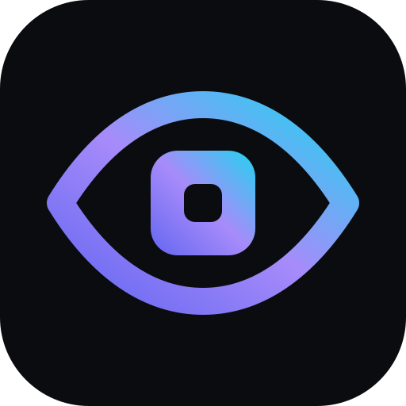
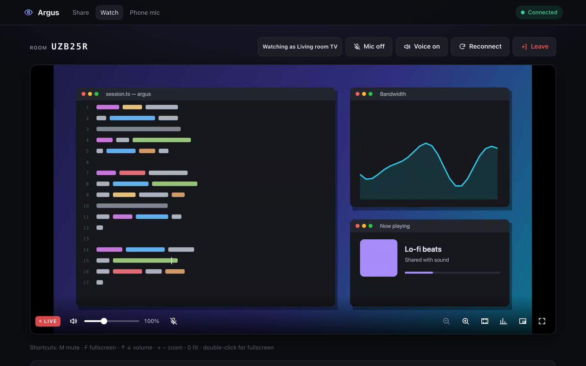
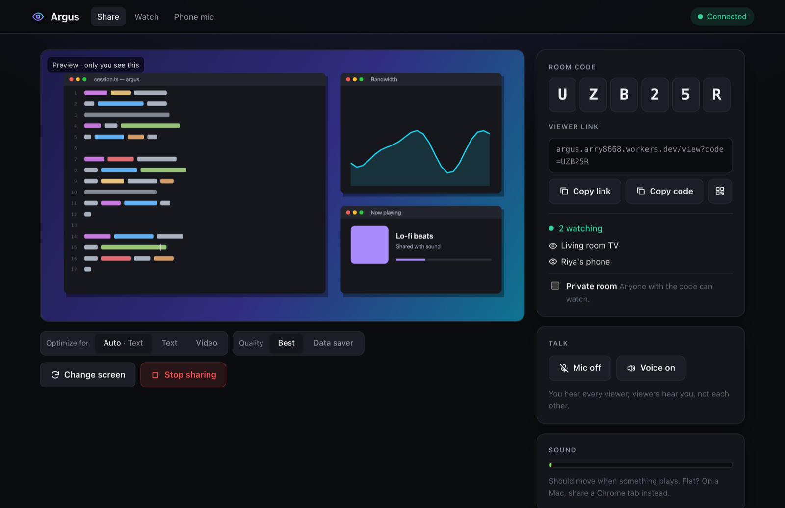
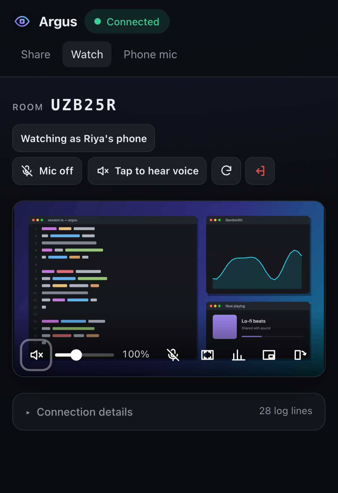
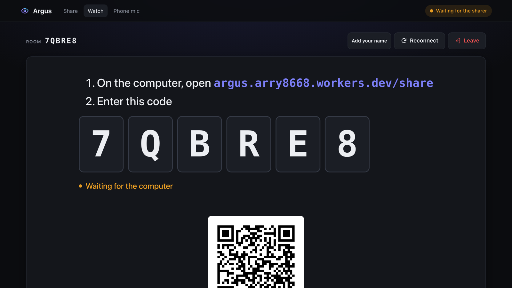
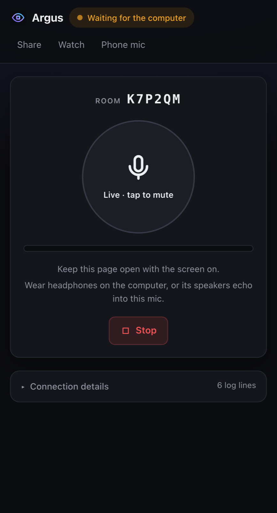
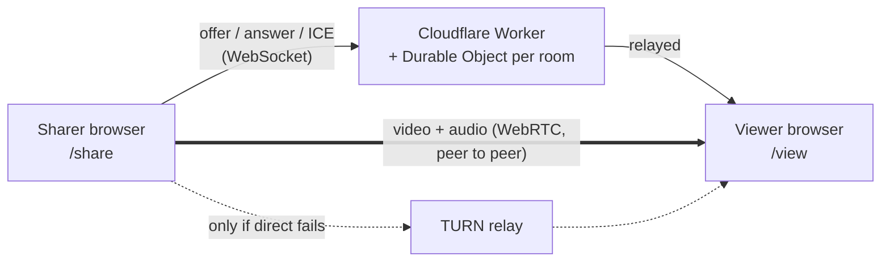

<p align="center">
  
</p>

<h1 align="center">Argus</h1>

<p align="center">
  <b>Your screen, anywhere.</b><br>
  Peer-to-peer screen sharing in the browser, plus your phone as a microphone.<br>
  No installs, no accounts.
</p>

<p align="center">
  <a href="https://argus.arry8668.workers.dev"><b>Open Argus →</b></a>
</p>

<picture>
  <source media="(prefers-color-scheme: light)" srcset="docs/images/watch-light.png">
  
</picture>

## What it does

- **Share a screen, window or tab** to up to 4 viewers: laptop, phone or TV browser.
- **Sub-second and private.** Video goes straight between browsers (WebRTC); the server
  only introduces them. When a network blocks direct connections, a TURN relay steps in.
- **Sound** with the picture (Chrome/Edge), or from a sound input like Stereo Mix in any browser.
- **Talk** both ways while sharing. Either side can switch their mic or the others' voices off.
- **Change screen** mid-share without anyone rejoining.
- **TV friendly**: the TV shows a code and a QR, you type it on the computer. No remote typing.
- **Private rooms**: viewers give a name and wait for you to let them in.
- **Phone as a mic** for a computer without one.
- Zoom, fit/fill, rotate (phones), picture-in-picture, volume boost to 300%, data saver,
  installable as an app.

<table>
  <tr>
    <td width="62%">
      <picture>
        <source media="(prefers-color-scheme: light)" srcset="docs/images/share-light.png">
        
      </picture>
    </td>
    <td width="38%">
      <picture>
        <source media="(prefers-color-scheme: light)" srcset="docs/images/phone-light.png">
        
      </picture>
    </td>
  </tr>
  <tr>
    <td>
      <picture>
        <source media="(prefers-color-scheme: light)" srcset="docs/images/tv-code-light.png">
        
      </picture>
    </td>
    <td>
      <picture>
        <source media="(prefers-color-scheme: light)" srcset="docs/images/mic-light.png">
        
      </picture>
    </td>
  </tr>
</table>

## Use it

**Share a screen**
1. On the computer, open [`/share`](https://argus.arry8668.workers.dev/share) → **Share screen**.
2. Send the code or link to whoever's watching. They open it and the picture appears.

**Watch on a TV**
1. On the TV browser, open [`/view`](https://argus.arry8668.workers.dev/view) → **Show a code on this screen**.
2. On the computer: `/share` → **Have a code from a TV?** → type it in.

**Sound**
- Chrome or Edge: pick **Entire screen** (Windows) or a **tab**, and tick *Share audio*.
  Window shares never carry sound.
- Firefox and Safari can't share sound. Use **Use a sound input** on the share page with
  Stereo Mix (Windows) or a virtual cable like BlackHole (Mac).

**Phone as a mic**
1. Computer: [`/listen`](https://argus.arry8668.workers.dev/listen) → Start listening.
2. Phone: [`/mic`](https://argus.arry8668.workers.dev/mic) → enter the code → Start mic.
3. For games and call apps, the computer needs a free virtual cable once (VB-Cable on
   Windows, BlackHole on Mac). The [`/setup`](https://argus.arry8668.workers.dev/setup)
   page walks through it.

Something off? Open **Connection details → Report a problem** on either side. It sends
the connection log (never video, audio or IP addresses) and shows a report ID.

## How it works



- A **Cloudflare Worker** serves the app. Each room code maps to one **Durable Object**
  that relays the WebRTC handshake between the sharer and viewers over WebSockets. It never
  sees the media.
- Browsers then connect directly, using **STUN** to find their public addresses. On
  networks where that fails (symmetric NAT, blocked UDP), media goes through a **TURN**
  relay instead. Diagnostics show which path won: `host` (same network), `srflx`
  (direct over the internet) or `relay`.
- The sharer sends one stream per viewer (a mesh), hence the 4-viewer cap.
- Codecs: H.264 by default so TVs and phones decode in hardware; VP8 whenever Firefox is
  on either side.
- Links survive network blips: the room connection reconnects on its own, and a live call
  isn't dropped while it does.

Everything runs on free tiers (Cloudflare Workers, Durable Objects, ExpressTURN).

## Develop

```sh
cd web
npm install
npm run dev            # Vite + local Worker and Durable Objects
npm run build          # typecheck + build
npm run lint
npm run deploy         # build + wrangler deploy
npm run check:relay    # signaling checks against the live Worker
node scripts/relay-check.mjs localhost:5173   # same, against npm run dev
npm run reports        # list problem reports (R-XXXXXX to read one)
```

Needs Node 20+ and a Cloudflare account (`npx wrangler login`).

**Secrets** (`npx wrangler secret put NAME`; for local dev put them in `web/.dev.vars`):

| Name | What |
| --- | --- |
| `TURN_URLS` | Comma-separated `turn:` URLs. Optional: without TURN it's STUN only. |
| `TURN_USERNAME`, `TURN_CREDENTIAL` | TURN credentials. |
| `REPORTS_TOKEN` | Lets `npm run reports` read problem reports. |

Live logs: `npx wrangler tail argus`. After editing `wrangler.jsonc`, run `npm run cf-typegen`.

<details>
<summary>Project layout</summary>

```
web/
├── worker/
│   ├── index.ts        Routes: /api/health, /api/ice, /api/room/:code/ws, /api/report(s)
│   ├── room.ts         RoomDO: per-room signaling relay (up to 4 viewers) + logs
│   └── reports.ts      ReportsDO: problem reports in SQLite, kept 30 days
├── src/
│   ├── pages/          Home, Share, View, Mic, Listen, Setup
│   ├── components/     Player, RoomCard, ViewerList, SoundInput, TvCode, QrCode, Details…
│   └── lib/
│       ├── session.ts  Sender (one call per viewer) and Receiver
│       ├── call.ts     One RTCPeerConnection: ICE, stats, diagnostics
│       ├── signaling.ts  WebSocket client with auto-reconnect
│       ├── capture.ts  Screen, camera and sound-input capture
│       └── …           voice chat, audio boost, auto-tuning, data saver, prefs
├── public/             Logo, app icons, manifest
├── scripts/            relay-check.mjs, reports.mjs
└── wrangler.jsonc      Worker, assets, Durable Objects
```

</details>

The first version (FFmpeg + HLS + localtunnel) lives in git history before `f7aefeb`.

## License

ISC
